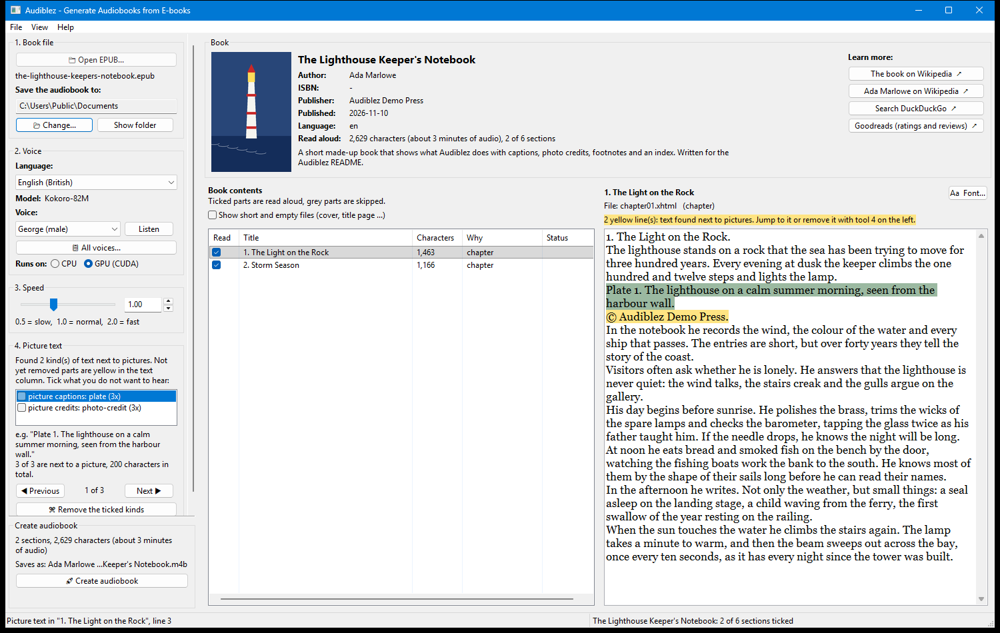
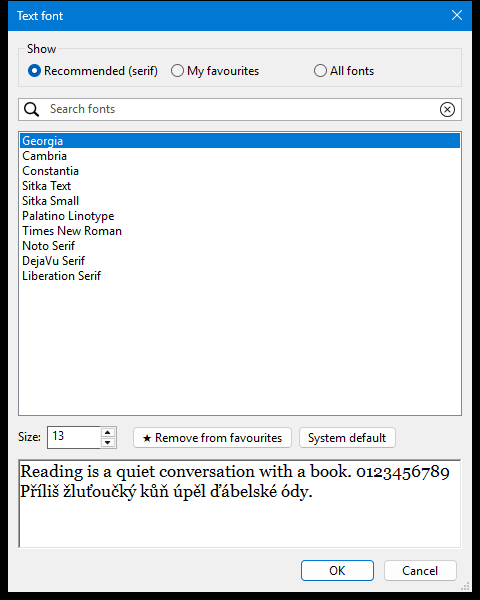
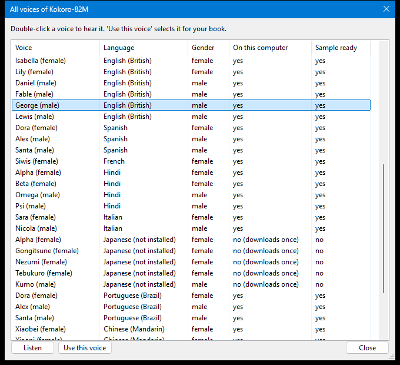

# Audiblez: generate audiobooks from e-books — dobrejakcyp fork

Audiblez turns `.epub` e-books into `.m4b` audiobooks with chapters, using the
[Kokoro-82M](https://huggingface.co/hexgrad/Kokoro-82M) text-to-speech model, locally on your own computer.

> **About this fork.** This is [dobrejakcyp](https://github.com/dobrejakcyp)'s fork of
> [santinic/audiblez](https://github.com/santinic/audiblez), created by **Claudio Santini** and its contributors.
> It is based on release v0.4.9; their code and full history are kept in this repository (tag `v0.4.9`), and
> it stays under the original MIT licence. All credit for Audiblez itself goes to them.
>
> The fork focuses on one thing: **hearing only the book itself** — without footnote numbers, picture
> captions, photo credits, indexes or contents pages read aloud — and on a window that makes it easy to check
> and adjust what will be read before a long conversion starts.



*The screenshots show a small made-up demo book, so no copyrighted book appears here.*

## What is different from the original

| | Original 0.4.9 | This fork (0.5.0+dobrejakcyp) |
|---|---|---|
| **Text cleaning** | captions with standard names are skipped | footnotes, note markers, indexes, contents lists and page numbers are removed too; you can see what was removed and why (`--report`) |
| **Picture text** | — | captions and photo credits are **found by their position next to pictures**, whatever the publisher called them; you can jump to each one and remove them |
| **Which parts are read** | files whose *name* looks like a chapter | real **chapter titles** from the book's table of contents; afterwords and prefaces are included, notes, index, copyright and similar pages are not; every row says **why** |
| **Window** | list of file names, settings on the side | tool column, book card with cover and links, contents list with greyed-out skipped parts, editable text with highlighting |
| **Voices** | voice list | languages and voices with readable names, **instant offline samples**, an "All voices" overview |
| **During conversion** | no way to stop except closing the program | **Stop** button; finished chapters are kept and a new start **continues where it stopped** |
| **Audiobook file name** | named after the EPUB file | `Author - Title.m4b` from the book's details |
| **Library** | — | **Import** copies a book into its own folder in one library folder, next to its audiobook; the **Library** window shows every book and whether it was opened, partly made or made into an audiobook |
| **Comfort** | — | read any highlighted text aloud (right-click), choose the **font** of the book text, status bar, settings remembered |
| **Packaging** | pip / Poetry | [uv](https://docs.astral.sh/uv/), with PyTorch's CUDA build locked in |

## Installation

You need [uv](https://docs.astral.sh/uv/), [git](https://git-scm.com/) and [ffmpeg](https://ffmpeg.org/)
(ffmpeg joins the chapters into the final `.m4b`). Python itself is installed by uv if needed (3.10–3.12).

### Windows (with the window)

```powershell
winget install --id=astral-sh.uv -e
winget install --id=Gyan.FFmpeg -e
git clone https://github.com/dobrejakcyp/audiblez
cd audiblez
uv sync --extra gui                     # creates .venv; on Windows PyTorch comes with CUDA (NVIDIA GPU) support
uv run python -m audiblez.voice_library # optional, once: makes the instant voice samples (a few minutes)
uv run audiblez-ui
```

To start it from the desktop, make a shortcut to `.venv\Scripts\python.exe` with the argument `-m audiblez.ui`
and "Start in" set to the project folder.

### Linux / WSL (command line)

```bash
git clone https://github.com/dobrejakcyp/audiblez && cd audiblez
uv sync                                  # command line only; the window needs wxPython (see below)
uv run audiblez book.epub --report       # what would be read, without making audio
uv run audiblez book.epub -v bm_george -c
```

The window can also run on Linux with `uv sync --extra gui`, but wxPython has no ready-made Linux packages on
PyPI, so it is built from source (install your distribution's GTK3 development package first).

**One folder for Windows and WSL.** If you work on the same project folder from both, Windows' uv keeps its
environment in `.venv`. Before running uv in that folder from WSL, point it somewhere else, otherwise it would
replace the Windows `.venv` with a Linux one:

```bash
export UV_PROJECT_ENVIRONMENT=~/.venvs/audiblez
```

## Using the window

**Tool column (left)** — in the order you use it; drag its edge to make it wider.

1. **Book** — **Import EPUB** copies books (from Downloads, say) into the library; the original files are not
   changed. Choose one book and it opens at once; choose several (Ctrl or Shift + click) and they are all imported
   and shown in the Library window. **Library** lists every imported book (also Ctrl+L). Below them: the library
   folder.
2. **Voice** — language, voice and CPU/GPU. **Listen** plays a sample at once; **All voices…** lists every
   voice with its language and gender, and whether it is on your computer.
3. **Speed** — slider or exact number (0.5–2.0); double-click the slider to go back to 1.0.
4. **Picture text** — the kinds of captions and photo credits found next to pictures. Pick one and use
   **◀ Previous / Next ▶** to jump to every place it occurs; tick the kinds you don't want to hear and press
   **Remove the ticked kinds**. Untick and press again to bring them back. The choice is remembered per book.

**Create audiobook** stays at the bottom: it shows how long the audiobook will be and its file name, and turns
into **Stop** while working. Stopping keeps the finished chapters; pressing Create again continues from there.

**The library** — one folder (by default `Documents\Audiobook Library`) with a folder per book:

```
Audiobook Library/
  library.json                     when each book was imported, last opened and made into an audiobook
  Yuval Noah Harari - Nexus/
    Nexus.epub                     the imported copy
    Yuval Noah Harari - Nexus.m4b  the audiobook
    work/                          chapter .wav files while it is being made (removed when done)
```

The Library window reads each book's status from its folder (✅ audiobook made, ⏸ partly made, 📖 opened,
📥 imported), so it is always right: delete an `.m4b` and the book shows as not made yet. Double-click a book to
open it.

**Book card (top)** — cover, author, ISBN, publisher, a short description and buttons that search for the
book and its author on Wikipedia, DuckDuckGo and Goodreads (nothing is looked up until you click).

**Book contents (middle)** — every part of the book in reading order, with its real title. Ticked parts are
read aloud, grey parts are skipped; the **Why** column explains each decision ("chapter", "notes",
"copyright", …). You can change any tick. Empty files (cover, title pages) are hidden unless you ask for them.

**Text (right)** — exactly what will be read aloud, and you can edit it. Lines are coloured by what they are:
chapter and part headings light blue, quotations lavender, picture text that has not been removed yellow (a
small legend sits above the text). Every chapter starts with a spoken heading such as "Part 1. Chapter One. Oil
Drops.", and quoted extracts are framed by "Quote." and "End quote." — all of them are ordinary lines you can
edit or delete. **Search the book** (the box above the text, or Ctrl+F) finds a word in every section and jumps
from place to place with ◀ ▶ (or Enter / Shift+Enter). **Highlight any text and right-click** to hear it with the chosen voice and speed.
**Aa Font…** (or View → Text font) chooses the font of this text:



It lists every font on your system, recommends good serif reading fonts you have installed, and lets you keep
your own favourites. Changes are shown live; Cancel restores the previous font.

The **status banner** at the bottom always says what the program is doing (opening a book shows each step). Errors flash red and warnings flash amber, and both stay coloured until the next message or until you click ✕; a finished job shows green and then fades.
Your choices — voice, speed, library folder, window size, column width, font — are saved in `settings.json` in the
project folder; delete it to go back to the defaults.

## Command line

```
usage: audiblez [-h] [--version] [-v VOICE] [-p] [-s SPEED] [-c] [-o FOLDER]
                [--report] [--drop-class CSS_CLASS]
                epub_file_path

  -v VOICE, --voice VOICE   narrating voice, e.g. bm_george (default) or af_sky
  -p, --pick                choose the chapters interactively
  -s SPEED, --speed SPEED   speed from 0.5 to 2.0
  -c, --cuda                use the GPU (CUDA) if available
  -o FOLDER, --output FOLDER  folder for the audiobook and temporary files
  --report                  only show what the cleaning removes and keeps; no audio is made
  --drop-class CSS_CLASS    also remove every element with this CSS class (repeatable)
  --version                 show the version
```

`--report` lists, per rule, how much was removed with examples, and the most common kinds of text that are kept.
That is the place to spot book-specific leftovers, which you can then remove with `--drop-class`.

## How the text cleaning works

1. **Rules** (`audiblez/cleaning_rules.py`) remove elements that should not be heard: captions, contents and
   page lists, page-number markers, the index, footnote and endnote text, note markers (but not exponents such
   as 2⁴), and references like "(see fig. 3)".
2. **Section selection** (`audiblez/chapter_selection.py`) decides which parts of the book are read: titles come
   from the table of contents; contents, notes, index, copyright, praise and similar pages are skipped;
   prefaces, introductions and afterwords are kept.
3. **Picture text detection** (`audiblez/picture_text_detector.py`) looks at the text right around every
   picture. A kind of paragraph that is nearly always next to a picture — and is only a small part of the book —
   is offered as a caption or photo credit. This works with any publisher's naming, because it relies on
   position, not on names.

Nothing is removed silently: the window shows what was skipped and why, and you can change every decision.

## Voices

Kokoro-82M is released under the Apache licence. Use `-v` on the command line or the Voice tool in the window.
The first letter of a voice is the language, the second its gender (`bm_george`: British English, male).

| Language | Voices |
|---|---|
| 🇺🇸 American English | `af_alloy`, `af_aoede`, `af_bella`, `af_heart`, `af_jessica`, `af_kore`, `af_nicole`, `af_nova`, `af_river`, `af_sarah`, `af_sky`, `am_adam`, `am_echo`, `am_eric`, `am_fenrir`, `am_liam`, `am_michael`, `am_onyx`, `am_puck`, `am_santa` |
| 🇬🇧 British English | `bf_alice`, `bf_emma`, `bf_isabella`, `bf_lily`, `bm_daniel`, `bm_fable`, `bm_george`, `bm_lewis` |
| 🇪🇸 Spanish | `ef_dora`, `em_alex`, `em_santa` |
| 🇫🇷 French | `ff_siwis` |
| 🇮🇳 Hindi | `hf_alpha`, `hf_beta`, `hm_omega`, `hm_psi` |
| 🇮🇹 Italian | `if_sara`, `im_nicola` |
| 🇯🇵 Japanese | `jf_alpha`, `jf_gongitsune`, `jf_nezumi`, `jf_tebukuro`, `jm_kumo` (needs the extra package `fugashi`) |
| 🇧🇷 Brazilian Portuguese | `pf_dora`, `pm_alex`, `pm_santa` |
| 🇨🇳 Mandarin Chinese | `zf_xiaobei`, `zf_xiaoni`, `zf_xiaoxiao`, `zf_xiaoyi`, `zm_yunjian`, `zm_yunxi`, `zm_yunxia`, `zm_yunyang` |



More about the voices' quality: [Kokoro-82M VOICES.md](https://huggingface.co/hexgrad/Kokoro-82M/blob/main/VOICES.md).
Voice files are downloaded once from Hugging Face the first time a voice is used (about 0.5 MB each).

**Speed.** On a laptop with an RTX 3070 Laptop GPU, a short English passage was read about 23× faster than real
time on the GPU and about 3× on the CPU — at that rate a 16-hour audiobook would take roughly 45 minutes on the GPU.
(The original README reports about 600 characters per second on a Google Colab T4 GPU.)

## Development

```
audiblez/
  cli.py, core.py               command line, conversion (core.main), m4b creation
  cleaning_rules.py             what is not read aloud (one small class per rule)
  epub_text_extractor.py        applies the rules, keeps a cleaning report per chapter
  chapter_selection.py          which parts are read, with titles and reasons
  picture_text_detector.py      captions and credits found by their position
  spoken_headings.py            "Chapter One. ..." and "Part 1." spoken at the start of chapters
  book_search.py                the search box: every place a text occurs in the book
  book_metadata.py              title, author (also "Surname, First" -> "First Surname"), ISBN, cover, links, file names
  voice_library.py, voices.py   languages, voices and the offline samples
  library.py                    the library folder, importing, library.json, each book's status
  settings.py, fonts.py         remembered settings; font lists
  ui*.py                        the window (wxPython)
  test_cleaning_rules.py        self-checks
```

Run the self-checks with `uv run python -m audiblez.test_cleaning_rules`. Each module starts with a short
explanation of what it does and why, written so it can be read without knowing the rest of the program.

The version `0.5.0+dobrejakcyp` uses a local version label: it marks a fork build, so it cannot be confused
with an official Audiblez release (and cannot be published to PyPI under the original name).

## Credits and licence

- **Audiblez** by [Claudio Santini](https://claudio.uk) (2025) and contributors —
  [santinic/audiblez](https://github.com/santinic/audiblez), MIT licence. Related article:
  [Audiblez v4: Generate Audiobooks from E-books](https://claudio.uk/posts/audiblez-v4.html).
- **This fork** by [dobrejakcyp](https://github.com/dobrejakcyp) (Lukáš Puška), MIT licence.
- **Kokoro-82M** by [hexgrad](https://huggingface.co/hexgrad/Kokoro-82M), Apache licence.
